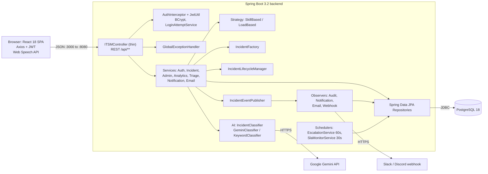
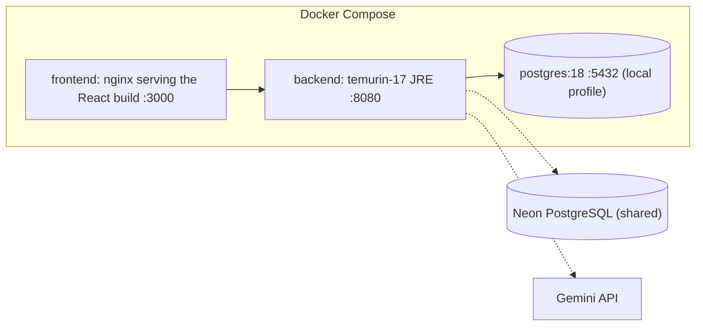
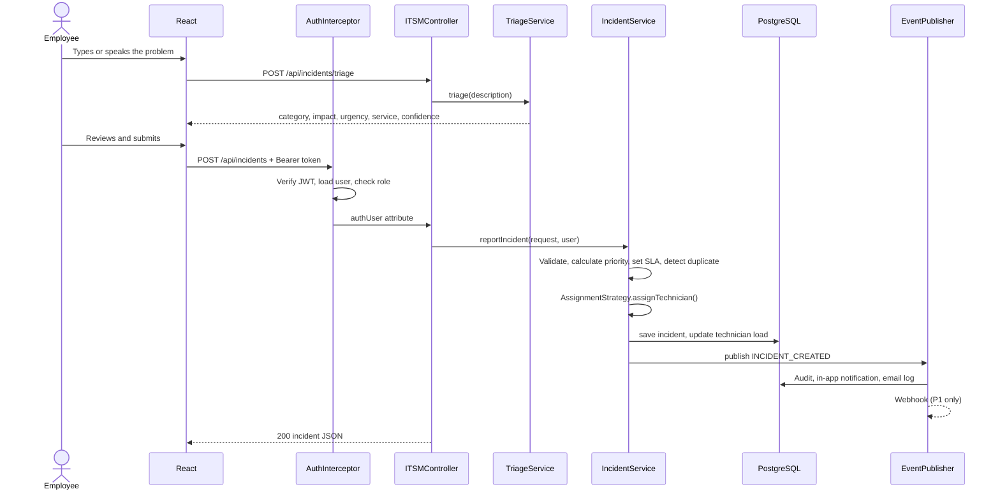
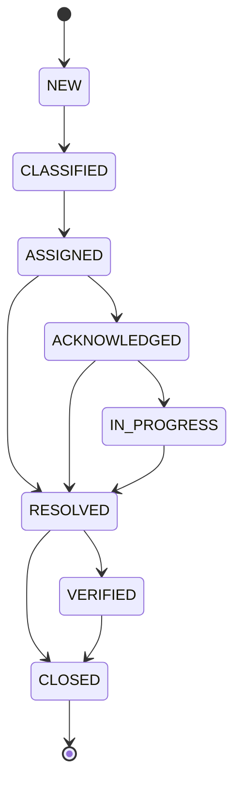

# I-ITSM Architecture

## 1. System Architecture

## 2. Layers
| Layer | Package | Responsibility |
|---|---|---|
| Presentation | `frontend/src` | Role-based dashboards, AI triage form with voice input |
| API | `controller` | Receives requests, calls services, returns JSON |
| Security | `security`, `config` | JWT check, role check, login lockout, BCrypt bean |
| Business logic | `service` | Incident rules, priority, SLA, escalation, admin, analytics, triage |
| Domain / patterns | `strategy`, `factory`, `observer`, `lifecycle`, `ai` | Assignment, creation, events, state rules, classification |
| Persistence | `repository`, `model` | JPA entities and repositories |
| Cross-cutting | `exception`, `dto` | Error handling, validated request/response objects |

## 3. Deployment

## 4. Create-Incident Sequence

## 5. Incident Lifecycle

