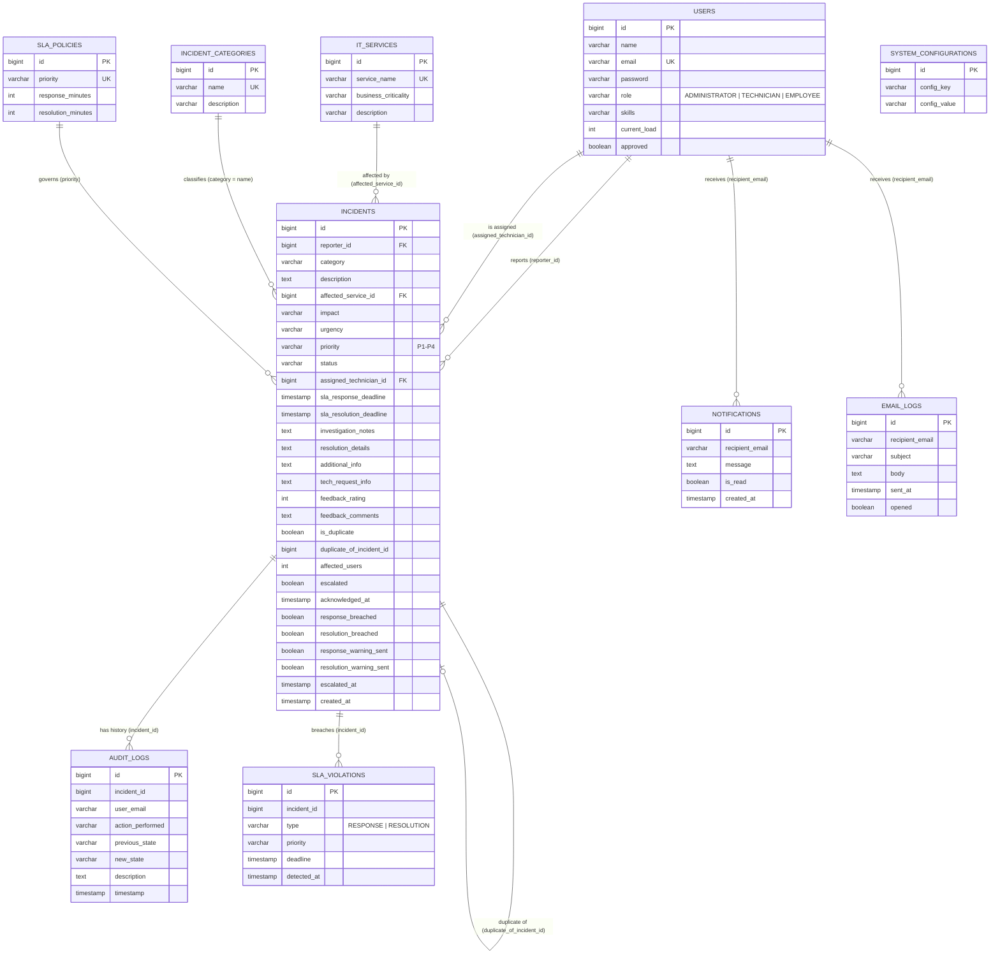

# I-ITSM Database Design

Database: PostgreSQL 18 (postgres:18-alpine in docker-compose). Tables are generated by Hibernate (`ddl-auto: update`) from the JPA entities in `backend/src/main/java/com/itsm/model`.

## 1. ER Diagram



## 2. Schema (reference DDL)

```sql
CREATE TABLE users (
    id            BIGSERIAL PRIMARY KEY,
    name          VARCHAR(255),
    email         VARCHAR(255) UNIQUE,
    password      VARCHAR(255),
    role          VARCHAR(255),              -- ADMINISTRATOR / TECHNICIAN / EMPLOYEE
    skills        VARCHAR(255),              -- comma separated, e.g. 'APPLICATION,DATABASE'
    current_load  INTEGER NOT NULL DEFAULT 0,
    approved      BOOLEAN NOT NULL DEFAULT TRUE
);

CREATE TABLE it_services (
    id                    BIGSERIAL PRIMARY KEY,
    service_name          VARCHAR(100) NOT NULL UNIQUE,
    business_criticality  VARCHAR(255) NOT NULL,   -- HIGH / MEDIUM / LOW
    description           VARCHAR(255)
);

CREATE TABLE incident_categories (
    id           BIGSERIAL PRIMARY KEY,
    name         VARCHAR(50) UNIQUE,
    description  VARCHAR(255)
);

CREATE TABLE sla_policies (
    id                  BIGSERIAL PRIMARY KEY,
    priority            VARCHAR(255) NOT NULL UNIQUE,   -- P1..P4
    response_minutes    INTEGER NOT NULL,
    resolution_minutes  INTEGER NOT NULL
);

CREATE TABLE system_configurations (
    id            BIGSERIAL PRIMARY KEY,
    config_key    VARCHAR(255),                         -- e.g. ASSIGNMENT_STRATEGY
    config_value  VARCHAR(255)                          -- SKILL_BASED / LOAD_BASED
);

CREATE TABLE incidents (
    id                        BIGSERIAL PRIMARY KEY,
    reporter_id               BIGINT REFERENCES users(id),
    category                  VARCHAR(255) NOT NULL,
    description               TEXT NOT NULL,
    affected_service_id       BIGINT REFERENCES it_services(id),
    impact                    VARCHAR(255) NOT NULL,
    urgency                   VARCHAR(255) NOT NULL,
    priority                  VARCHAR(255),
    status                    VARCHAR(255),
    assigned_technician_id    BIGINT REFERENCES users(id),
    sla_response_deadline     TIMESTAMP,
    sla_resolution_deadline   TIMESTAMP,
    investigation_notes       TEXT,
    resolution_details        TEXT,
    additional_info           TEXT,
    tech_request_info         TEXT,
    feedback_rating           INTEGER,
    feedback_comments         TEXT,
    is_duplicate              BOOLEAN NOT NULL DEFAULT FALSE,
    duplicate_of_incident_id  BIGINT,
    affected_users            INTEGER DEFAULT 1,
    escalated                 BOOLEAN DEFAULT FALSE,
    escalated_at              TIMESTAMP,
    acknowledged_at           TIMESTAMP,
    response_breached         BOOLEAN DEFAULT FALSE,
    resolution_breached       BOOLEAN DEFAULT FALSE,
    response_warning_sent     BOOLEAN DEFAULT FALSE,
    resolution_warning_sent   BOOLEAN DEFAULT FALSE,
    created_at                TIMESTAMP
);

CREATE TABLE email_logs (
    id               BIGSERIAL PRIMARY KEY,
    recipient_email  VARCHAR(255),
    subject          VARCHAR(255),
    body             TEXT,
    sent_at          TIMESTAMP,
    opened           BOOLEAN DEFAULT FALSE
);

CREATE TABLE sla_violations (
    id           BIGSERIAL PRIMARY KEY,
    incident_id  BIGINT,
    type         VARCHAR(255),      -- RESPONSE / RESOLUTION
    priority     VARCHAR(255),
    deadline     TIMESTAMP,
    detected_at  TIMESTAMP
);

CREATE TABLE audit_logs (
    id                BIGSERIAL PRIMARY KEY,
    incident_id       BIGINT,
    user_email        VARCHAR(255),
    action_performed  VARCHAR(255),
    previous_state    VARCHAR(255),
    new_state         VARCHAR(255),
    description       TEXT,
    "timestamp"       TIMESTAMP
);

CREATE TABLE notifications (
    id               BIGSERIAL PRIMARY KEY,
    recipient_email  VARCHAR(255),
    message          TEXT,
    is_read          BOOLEAN NOT NULL DEFAULT FALSE,
    created_at       TIMESTAMP
);
```

## 3. Important Relationships

| Relationship | Type | How it is enforced |
|---|---|---|
| users → incidents (reporter) | 1 : N | FK `incidents.reporter_id` |
| users → incidents (technician) | 1 : N | FK `incidents.assigned_technician_id` |
| it_services → incidents | 1 : N | FK `incidents.affected_service_id` |
| incidents → audit_logs | 1 : N | Logical link `audit_logs.incident_id` (no DB FK) |
| users → notifications | 1 : N | Logical link `notifications.recipient_email = users.email` |
| incident_categories → incidents | 1 : N | Logical link `incidents.category = incident_categories.name` (stored uppercase) |
| sla_policies → incidents | 1 : N | Logical link `incidents.priority = sla_policies.priority`; used to compute SLA deadlines |
| incidents → incidents | 1 : 0..1 | Logical self link `duplicate_of_incident_id` |
| system_configurations | standalone | Key/value settings (`ASSIGNMENT_STRATEGY`) read when assigning technicians |

Business rules stored in the data:
   - Priority: effective impact = average of (incident impact, service criticality, affected-users level: <10 low, <100 medium, otherwise high). Effective impact HIGH and urgency HIGH gives P1. Either HIGH gives P2. Both LOW gives P4. Anything else gives P3.
   - Auto-escalation: `EscalationService` runs every 60 s and raises priority one step when the response or resolution SLA deadline is missed.
- SLA deadlines are computed from `sla_policies` when the incident is created.
- Lifecycle: NEW → CLASSIFIED → ASSIGNED → ACKNOWLEDGED → IN_PROGRESS → RESOLVED → VERIFIED → CLOSED (see `IncidentLifecycleManager`).
- `users.current_load` is increased on assignment and decreased on resolve. The load-based strategy uses it.

## 4. Sample Data

Lookup data is seeded automatically on first start by `DataInitializer`:
- Users: `admin@gmail.com`, `tech.alice@gmail.com`, `tech.bob@gmail.com`, `employee@gmail.com`
- 9 categories, 3 IT services, SLA policies P1 to P4, config `ASSIGNMENT_STRATEGY=SKILL_BASED`

Transactional sample data (incidents, audit logs, notifications) is in `docs/sample-data.sql`.